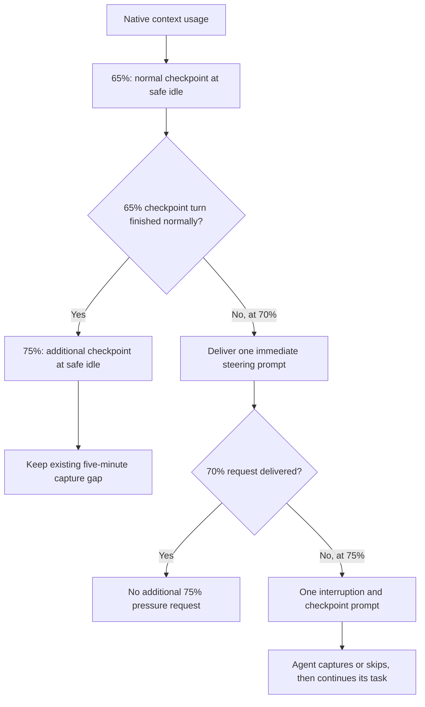

# Pressure checkpoint escalation

## Responsibility boundary

The bridge schedules and delivers checkpoint prompts from native context usage
and small persisted request bookkeeping. It does not inspect notes, judge
capture quality, analyze the task, or decide how interrupted work should resume.
The session agent owns capture and continuation.

There is no checkpoint-completion acknowledgement, new token-growth gate,
whole-task deadline, failure/continuation controller, polling or history scan.
Existing bounded RPC waits and sanitized failure logs remain.

## Pressure policy



- Use valid unrounded native token percentages. The existing configurable
  normal threshold defaults to 65%; new escalation boundaries are 70% and 75%.
- The normal 65% checkpoint uses the agreed normally-finished checkpoint-turn
  criterion, even when saving is skipped. This is a mechanical lifecycle event,
  not assessment of a note or the user's work.
- The 70% request uses a matched native message-delivery event. Acceptance into
  a queue is not delivery. No extra completion acknowledgement is required.
- A normally finished 65% checkpoint skips 70% steering and permits one additional
  75% normal request at safe idle, retaining the existing five-minute gap.
- If the normal checkpoint has not happened and no checkpoint is already running,
  the 70% step bypasses idle and sends
  `mode: immediate`. Once that request reaches the agent, omit both the
  additional 75% pressure request and aggressive 75% interruption.
- If the 70% request has not reached the agent by 75%, or the first observed
  high-pressure update is already at or above 75%, the emergency step may
  interrupt ordinary execution and send one checkpoint/continue prompt.
- Do not interrupt a bridge checkpoint already delivered and running.
- Each escalation step is attempted once per context cycle; no repeated
  steering/cancellation loop. Successful compaction and explicit context
  clearing begin a new cycle. Lower token readings alone do not reset stages.
- Disable, user cancellation, compaction and existing in-flight guards remain
  meaningful. Manage only the bridge's own pending requests when replacing a
  checkpoint; never clear unrelated queued work.
- A native interrupted-idle event pauses new escalation across reload until
  fresh user work arrives. Do not guess whether that event came from a user
  or the bridge's cancellation call. If it arrives during the emergency
  handoff, honor it rather than overriding it with another prompt.

The bridge uses existing lifecycle/delivery events, not guesses about what the
agent has done. No new confirmation API or analysis of the user task is introduced.

## Prompt wording

The actual prompt begins with its type, inside square brackets:

```text
[basic-memory-bridge: standard-interval-checkpoint]
[basic-memory-bridge: pressure-checkpoint]
[basic-memory-bridge: emergency-checkpoint]
```

Periodic requests use the first type; normal/additional pressure and 70%
steering use the second; the aggressive 75% request uses the third. The ordinary
memory-capture guidance and provenance remain. Remove the conflicting instruction
to finish normally and end with:

```text
After capturing memory or deciding not to, resume your previous unfinished task, respecting newer instructions and explicit stop/cancel requests.
```

This asks the agent to continue. It is not a bridge-managed pause/resume promise.
Post-compaction read-only recovery remains a separate existing behavior.

## Mechanical implementation

- Reuse pushed `session.usage_info`, native message-delivery events, the existing
  serialized event queue and per-session atomic state store.
- Persist bounded per-cycle delivery/attempt markers with the existing request
  identity. Missing fields on older state start prospectively; do not reconstruct
  previous deliveries from note contents or old session journals.
- Reuse existing `session.send` with enqueue for normal requests and immediate
  for 70% steering. The only new runtime API is the specifically approved
  `session.abort()` at the 75% emergency step.
- Recheck locally observed delivery before interruption. An already observed
  70% delivery suppresses cancellation even if it arrived during earlier awaits.
- Use existing queue inspection/removal only when managing an owned pending
  checkpoint to avoid duplicate requests; no new queue-control API.
- Keep existing periodic thresholds and capture history, and prevent resumed
  ordinary work from being mislabeled as a pending steered request. Receiving
  a steered prompt is not logged as a saved capture or a finished user task.
- RPC failure logs the failed operation and ends that escalation attempt.
  No custom timer is added around the agent's subsequent work.
- Before aggressive cancellation, use one existing queue snapshot. If unrelated
  queued work or steering is present, keep the earlier request and log
  `emergency-skipped-queued-work`. Show a warning asking the user to pause pending
  work and request memory-capture manually. Do not abort, remove that work or
  watch/retry the queue. This consumes that cycle's emergency attempt; the
  warning does not promise automatic retry when work is paused.

## Known limitations and approval

Immediate steering is read at a subsequent model request; it is not an
instantaneous tool interruption. Cancellation is not an exact resumable pause
and may not immediately stop every tool/subprocess. Compaction can race delivery
or cancellation. No atomic delivery-and-cancellation guarantee is claimed.
The isolated native probe also confirmed that plain abort clears pending
queued user messages. The user approved a single pre-abort queue check with
the explicit residual race: a message arriving after the check can still be
discarded. No queue backup/restore or replacement interruption API is used.

The user explicitly approved introducing `session.abort()` at 75% with the
cancellation, tool/subprocess and compaction-race limitations. No other new API
or task/quality controller is approved. Raise new concrete risks before adding
anything outside this scope.

The existing event-only unloaded-compaction limitation is unchanged. Do not
install this feature or merge it to main merely because implementation tests pass.

## Logs and validation

Reuse the existing capped metadata-only logger. Record stage, attempt, native
delivery, interruption request/result, suppression reason and cycle, without
raw prompt/task/note contents. Say delivered, not captured/saved.

Tests must cover exact boundaries, delivery rather than acceptance, no-idle
steering, suppression after delivery, the additional idle-only request/cooldown,
jumps to 75%, one-shot attempts, disable/cancellation, compaction/clear/reload,
owned pending requests, headers and continuation wording. Existing checkpoint,
recovery, status and privacy tests remain relevant.
